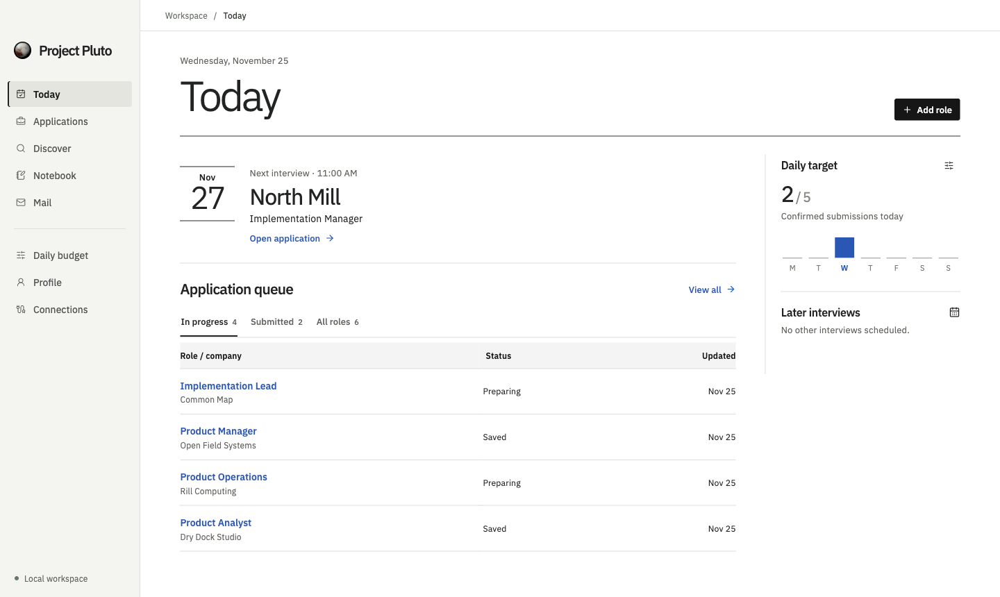

# PROJECT PLUTO

A local desktop workspace for finding roles, preparing applications, keeping submission receipts and organizing interview notes. Available for macOS and Windows.

[Download the desktop app](https://github.com/Jwarren-ENG/project-pluto/releases/latest) · [Installation guide](docs/install.md) · [License](LICENSE)



## Start your search

1. Open **Today** and choose **Start with your résumé**. Import a file or paste your experience. Review the extracted facts and confirm the details you want saved. You can add work examples, location preferences and a selected excerpt from a previous chat. [Profile guide](docs/profile.md)
2. In **Daily budget**, move the jobs per day slider. Choose your model and check the input and output rates. The estimate updates as you move the slider. Save your target to track the day's progress on Today. [Budget guide](docs/budget.md). Each estimate depends on the amount of research, writing and tool use per application.
3. Go to **Applications** to save a job from its employer's posting. For an assisted search, configure Firecrawl in **Connections** and enter a role and location under **Discover**. The daily discovery option runs while the app is open.
4. Open a saved role to prepare your materials. With a provider connected, you can request a draft based on confirmed experience, edit it and save your reviewed résumé as a PDF. Open the employer's application, fill in the form and submit on the employer's site. Right click inside the form or press Command Shift F on Mac or Control Shift F on Windows to fill supported contact fields.
5. Record the employer confirmation and change the stage to **Applied**. The application retains a copy of the résumé text, draft and evidence saved at that moment. For an interview, add the invitation and appointment time.

## Connect the services you use

| To do this | Open |
| --- | --- |
| Draft using OpenAI, Anthropic, OpenRouter, a compatible endpoint or a local Ollama model | [AI providers and search](docs/providers.md) |
| Review relevant Gmail or Outlook replies and associate one with an application | [Mail setup](docs/mail.md) |
| Keep Markdown notes or exchange them with an optional Obsidian vault | [Workspace and vault](docs/workspace.md) |

The app starts with an empty workspace. It keeps your records in the current operating system user's application data directory. API credentials use operating system protected encryption. Your résumé, job records and notes are stored locally in a database. A vault export creates readable Markdown files in the folder you choose. Select a private folder if your materials contain personal information.

AI requests use the provider you configure. Firecrawl uses its own credits. A chat subscription and developer API billing can have different terms. A local model can be used without a hosted model fee. The app can also track applications and notes without a provider.

## Run from source

Install Node.js 24 and npm. In the project folder, run:

```sh
npm ci
node node_modules/electron/install.js
npm start
```

Run `npm test` for the component and service checks. Run `npm run build` followed by `npm run smoke` to test the actual desktop window in a temporary workspace. Use `npm run dist` to build the installer on a supported platform. See the [desktop architecture](docs/architecture.md) and [third party credits](THIRD_PARTY.md).

For a guided workflow inside a chat assistant, see the [#LOCKEDIN Job Kit](https://github.com/Jwarren-ENG/lockedin-job-kit).
