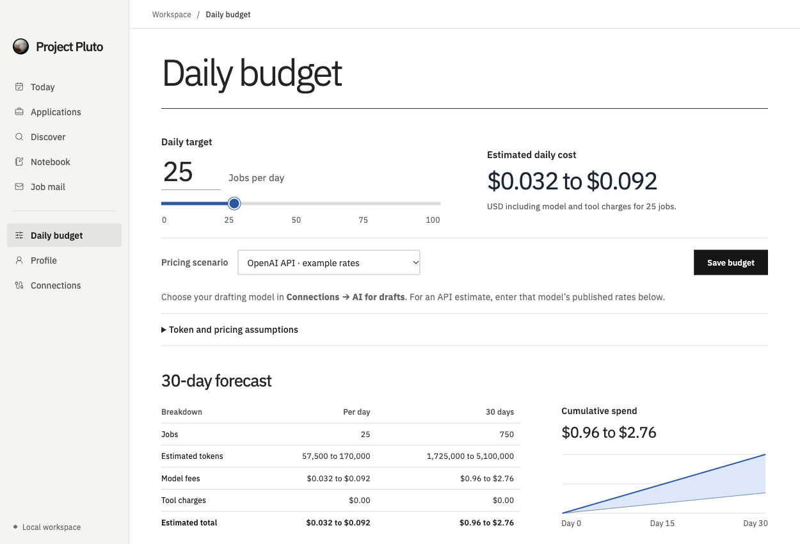

# Budget planner

If **ChatGPT subscription · Codex** is your active draft provider and you have no saved budget, the planner opens with **Subscription plan** selected. The daily token range estimates drafting workload. Actual access and limits come from your ChatGPT plan. Enter your monthly fee only if you want to spread it across 30 days. [Connect Codex](providers.md) · [Codex plan limits](https://help.openai.com/en/articles/11369540-using-codex-with-your-chatgpt-plan)

Set a daily job target with the slider or type an exact number. The live readout shows estimated daily cost, or estimated daily tokens for a subscription. Open **Token and pricing assumptions** to edit the low and high estimates for one role. Count input tokens for the prompt, profile and job details, and output tokens for the response. Include retries if they are part of your usual workflow.

The planner shows USD per day and across 30 days at the same target. Editing changes the projection immediately. **Save budget** stores the settings on this device. **Today** shows how many submissions have receipts against that target. Your saved scenario takes precedence even if you later switch draft providers. Choosing a scenario in the planner changes only the estimate. Firecrawl and other tool charges belong in the separate tool-cost field.

The cumulative chart opens at day 30. Point to a day, drag across the plot, or tap it to inspect days 0 through 30. With the chart focused, the arrow keys move one day and Home and End select the endpoints. The chart marker, amount and **Through day** column move together. The **Per day** column gives you the daily baseline. Exploring a day is temporary and requires no save.

## Pricing scenarios

Choose your drafting model in **Connections → AI for drafts**. The Budget panel’s OpenAI and Anthropic examples use rates recorded for the models below. To estimate a different model, look up its exact ID and billing tier, then enter its published input and output prices in USD per million tokens under **Token and pricing assumptions**. If either price is unknown, the model’s cost is unknown. Refreshing the model list leaves the estimate as entered. [Choose a drafting model](providers.md#choose-a-drafting-model)

| Scenario | Starting input / output rate per million tokens | Basis |
| --- | --- | --- |
| OpenAI API example · GPT-4.1 mini | $0.40 / $1.60 | Standard uncached pricing checked November 25, 2026. [OpenAI model pricing](https://developers.openai.com/api/docs/models/gpt-4.1-mini) |
| Anthropic API example · Claude Sonnet 4.6 | $3 / $15 | Standard pricing checked November 25, 2026. [Anthropic model pricing](https://platform.claude.com/docs/en/models/sonnet-4-6/overview) |
| OpenRouter and custom API | $1 / $4 | Illustrative rates. Enter the selected model and account’s actual input and output rates before using the estimate. |
| Local Ollama | $0 provider fee | Hardware and electricity are outside the estimate. Paid tools can still incur charges. |
| Subscription | Optional monthly fee supplied by the user | Shows estimated jobs and tokens. Entitlements and usage limits depend on the plan. A blank fee leaves the total unspecified. |

Each hosted API scenario retains its own edited rates. The generic workload starts at 10 jobs per day, 2,000 to 6,000 input tokens and 300 to 800 output tokens per role. Tool cost starts at $0 per role. Enter an expected cost for Firecrawl or other separately billed services. These starting assumptions are editable. Discounts, cached input pricing, taxes and tiered billing require adjustments to the assumptions.

If you enable the OmniRoute fallback, a zero input and output rate applies only to drafts handled by a verified free OpenRouter model. Estimate primary model usage and tool charges separately. The planner uses one pricing scenario at a time. [Free fallback setup](providers.md#free-fallback-with-omniroute)

## Calculation

For either end of the range, multiply input tokens by the input rate and output tokens by the output rate. Add those two amounts, divide by one million and multiply by the daily job target. Expected daily tool charges equal jobs per day multiplied by tool cost per role. The 30 day estimate uses 30 times the daily workload. Subscription mode spreads the supplied monthly fee across 30 days, including days with zero jobs. It adds the expected tool charges separately.

## Integration and checks

Mount the default export from `ui/Budget.jsx` with the standard `{ state, refresh, notify }` props. When `state.profile.budget` is absent, the panel reads only `activeProvider` from the public `providers.settings` result. A late response cannot replace a choice the user has edited or saved. Opening the panel does not write to the profile. The panel calls `workspace.saveProfile` with only `{ budget }` on explicit save. The workspace merges that field into the profile. Version 1 stores the scenario, daily job target, four token bounds, per-provider rate overrides, per-role tool cost and nullable monthly subscription fee. Rate cards and calculations live in `ui/budget-estimate.mjs`.

Run `node --test tests/budget.test.mjs` for range arithmetic, subscription and local scenarios, validation, migration from partial settings, and persistence in an isolated workspace. After building the renderer, run `node tests/budget-initial-provider.mjs` to check initial provider selection and delayed responses in a disposable Electron window.

Run `node tests/budget-chart-smoke.mjs` after building the renderer to verify chart selection with a mouse, keyboard and emulated touch in Electron. Pass a renderer build directory as the first argument to test a separate build.
