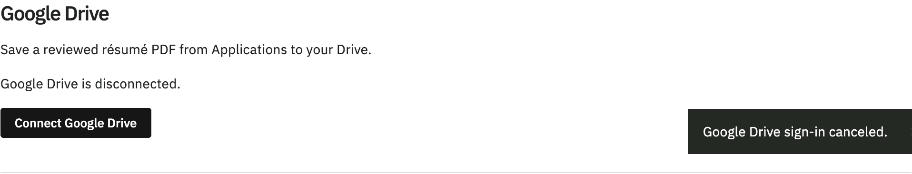
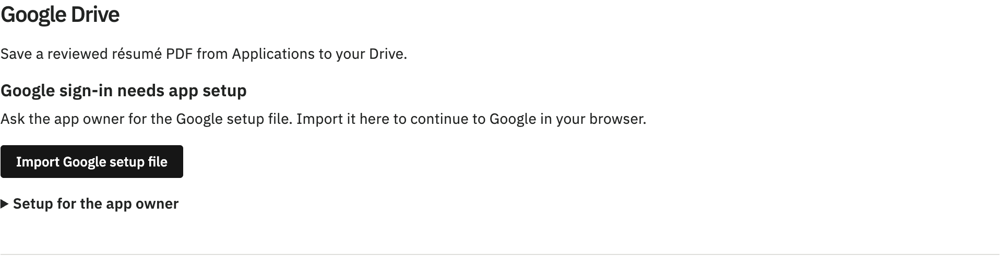

# Save a reviewed résumé to Google Drive

In **Connections → Google Drive**, select **Connect Google Drive**. When your edition includes a Google desktop registration, this opens Google’s consent screen in your system browser. Choose the account where you want your PDFs saved. On return, Pluto shows the connected email address. **Cancel Drive sign-in** closes the pending request.

Drive has its own opt-in. A publisher can supply the same Google desktop client registration for Gmail and Drive. Pluto requests consent for Drive separately and keeps its refresh grant in its own encrypted record. Connecting a mailbox or signing in to ChatGPT grants no Drive access. The only requested Google scope is `https://www.googleapis.com/auth/drive.file`, which covers files the app creates or that the user explicitly makes available to it. [Google Drive scopes](https://developers.google.com/workspace/drive/api/guides/api-specific-auth)

## Save a PDF

1. In **Applications**, open the saved role and review and save its résumé text.
2. Choose **Save to Google Drive**. Pluto generates a PDF from the role’s saved résumé. Google Drive receives the file and filename. A new file appears in the connected account’s My Drive.
3. Pluto confirms the save after Drive returns a matching file ID and SHA-256 checksum. Saving again uses the same file for that role and account. Revised PDF content updates the file. A retry after a lost response reuses the reserved ID, including after restarting Pluto. [Google Drive upload guide](https://developers.google.com/workspace/drive/api/guides/manage-uploads)

Uploads happen only when you choose **Save to Google Drive**. Pluto does not scan Drive or change file sharing. Unlinking leaves uploaded files in Drive.

## Set up Google sign-in for your users

The app publisher registers Project Pluto with Google once. Distribute a build with that registration so everyone who installs it can choose **Connect Google Drive**, pick an account and approve file access.

1. In Google Cloud, select the project that owns Project Pluto, enable the **Google Drive API**, and configure the app name, support contact and OAuth audience. While the app is in testing, add the Google accounts that will test it. [Google Auth Platform](https://console.cloud.google.com/auth/overview)
2. Create an OAuth client of type **Desktop app**. For distributed builds, use the client ID and optional desktop secret in the repository's build settings. The build workflow includes them in the installer. Only use a registration intended for installed desktop apps. [Build settings](mail.md#set-up-one-click-sign-in-for-a-distribution) · [Google desktop OAuth setup](https://developers.google.com/identity/protocols/oauth2/native-app)
3. To set up an individual installation, download the desktop client's JSON file from Google Cloud. Under **Connections → Google Drive**, choose **Import Google setup file** and select it in the file picker. Pluto remembers the registration on this device and opens Google in your browser. After unlinking, **Connect Google Drive** opens Google directly. If you only have the client details in text form, expand **Setup for the app owner**.

Importing a setup file identifies the app to Google. Each user grants access to their own Drive through Google's consent screen.

The sign-in uses an IPv4 loopback address on a temporary port, a fresh state value and S256 PKCE. Access tokens stay in memory. The operating system’s protected credential store holds the refresh grant and client details. Pluto refreshes the grant when an explicit upload needs it.

## Unlink or revoke access

**Unlink Google Drive** removes the account’s grant from this device. An imported app registration stays available for the next sign-in. **Revoke Google access → Revoke and unlink** also sends a revocation request to Google. Google revokes this account’s grants for every client in the same Google Cloud project. If Gmail uses that project, you may need to sign in to Gmail again. If Google cannot confirm revocation, Pluto keeps the local grant so you can retry or unlink locally. [Google revocation behavior](https://developers.google.com/identity/protocols/oauth2/native-app#tokenrevoke)

## Desktop integration

Mount the default export from `ui/DriveConnection.jsx` with `{notify}`. In main, create the service with `createDrive({prefs, secrets, openExternal, registrations, pickRegistrationFile, fetchImpl})`. The optional `registrations.gmail` entry contains the publisher’s Google desktop client ID and optional secret. The optional `fetchImpl` allows offline tests. The public connection state is `{connected, email, busy, registrationAvailable}`. A disconnected account has an empty email. An imported registration adds `registrationSource: 'imported'` to public state. The native picker keeps the selected file path and contents in the main process.

| Renderer action | Input | Result |
| --- | --- | --- |
| `drive.settings` | `{}` | Public connection state from local storage. |
| `drive.importRegistration` | `{}` | Opens the native JSON picker. Returns public state after saving setup, or null when canceled. |
| `drive.connect` | `{}` when a publisher or imported registration is available, otherwise `{clientId, clientSecret?}` | Public state after consent, identity verification and secure storage. |
| `drive.cancel` | `{}` | Cancels a pending sign-in, waits for callback cleanup, and returns public state. |
| `drive.disconnect` | `{}` for local unlink or `{revoke: true}` after confirmation | Public state after unlinking. |
| `application.drivePdf` | `{id, updatedAt}` for the reviewed application revision | Main resolves the reviewed résumé and returns `{id, name, url, alreadySaved}` for the verified Drive file. |

Main constructs the filename and PDF bytes and calls `uploadResume({pdf: Buffer, filename, jobId})`. The renderer supplies the role ID and revision timestamp. Main verifies the revision again after generating the PDF. The service accepts a PDF up to 5 MB. A local entry stores a reserved Drive file ID per Google desktop client, account and role. Pluto checks the file’s app-private role marker before updating it. It verifies file contents before confirming an upload or returning an existing receipt. Call the service’s `close()` on quit to cancel active work.

Run `node --test tests/drive.test.mjs` for synthetic consent, grant separation, cancellation, revocation, upload verification and recovery checks. The tests open real local callback listeners and use fictional Google responses.
