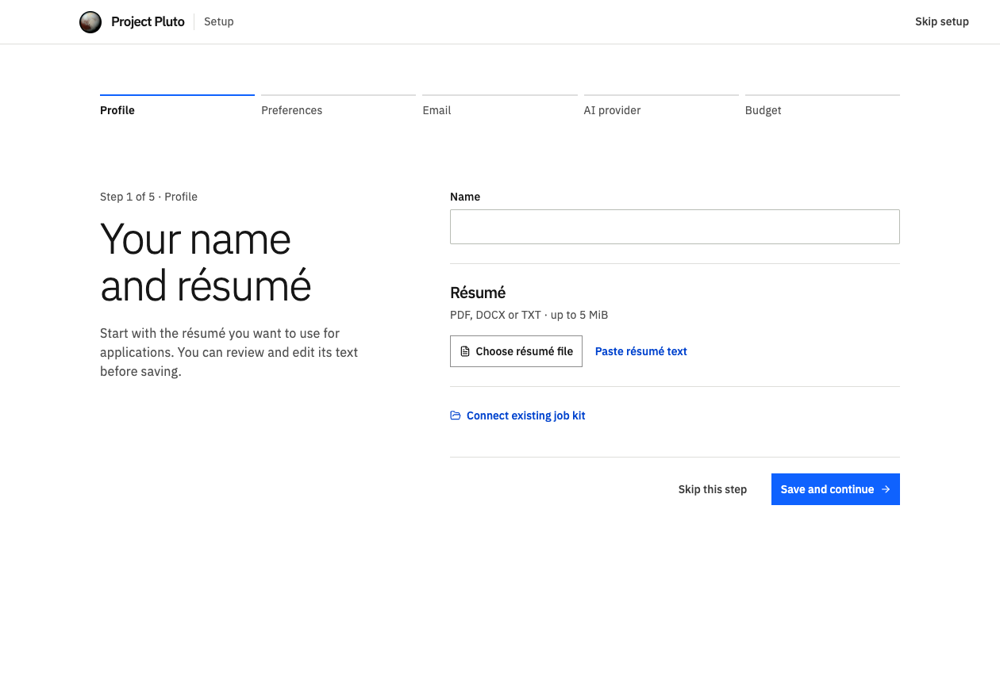
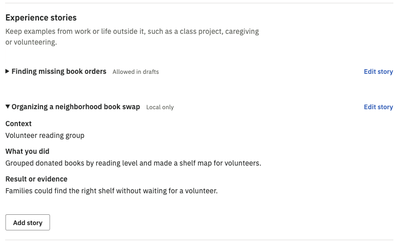
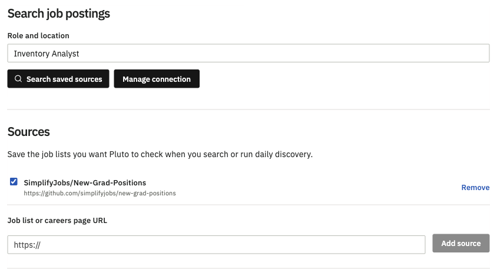
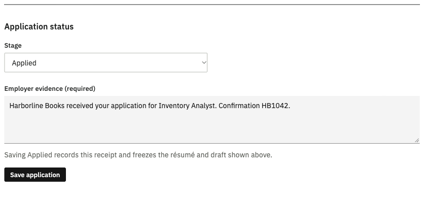
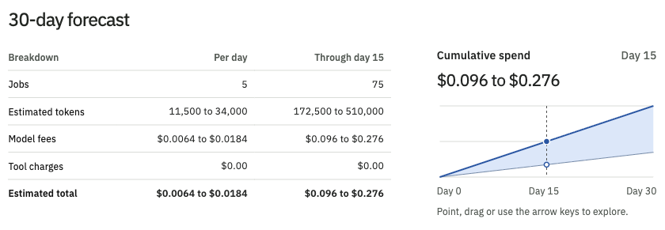

# Getting started with Project Pluto

This guide shows **Project Pluto v0.2.5**. Older GitHub installers may show different screens.

This walkthrough takes you from an empty workspace to a saved employer receipt. The screenshots follow a fictional applicant tracking an Inventory Analyst opening at Harborline Books. You can follow along with a real posting and leave it at **Saved** until you’re ready to apply.

## 1. Open your workspace

Launch **Project Pluto** on your Mac or Windows computer. A new workspace opens at **Your name and résumé**. Enter your name and use **Choose résumé file** to select a PDF, DOCX or TXT file up to 5 MiB. You can also choose **Paste résumé text**. Read the text, correct anything the file reader missed, then choose **Save and continue**. You can save just your name. [Choose the right installer](install.md#choose-an-installer)

If you already keep your applications in a job kit folder, choose **Connect existing job kit** on this first screen to import it. Existing Pluto workspaces open directly in **Today**. Choose **Open setup** in the sidebar to revisit any step.

1. In **Preferences**, enter your target roles, preferred locations and availability. Choose **Save and continue**.
2. In **Email**, choose an inbox to connect or continue without one. You can check for employer replies later in **Job mail**.
3. In **AI provider**, choose your subscription or configure an API or local model. An account sign-in and the choice of provider for drafts are separate actions. The provider controls show which action is available on your computer.
4. In **Budget**, change **Jobs per day** or **Pricing scenario** to see the estimate update. Choose **Save budget and open Today** to keep it, or **Skip this step** to leave your budget as it is.

Closing Pluto during setup keeps your place and unfinished profile or budget entries on this device. **Back** lets you review a previous step. **Skip this step** drops unsaved edits on the current step. **Skip setup** opens Today and clears the remaining draft. Previously saved details and completed connections stay in your workspace.

## 2. Review facts and add more to your profile

Open **Profile** from the sidebar. If your profile already has a name or résumé, choose **Edit profile**. Otherwise, choose a résumé file or expand **Paste résumé text**. Select **Review facts** to see suggested details from your résumé.

Under **Facts to keep**, open **View source** to compare a suggestion with your original wording. Edit the fact or clear its checkbox. If the original résumé text also needs a correction, use **Back** to edit it. Choose **Continue to preferences** and enter any target roles or locations.

On **Set your job preferences**, find **Experience stories** and choose **Add story**. Give your example a title and describe the context, what you did, and the result. Morgan’s book swap is an example from outside work. For the result, Morgan describes how families could find the right shelf on their own.

A new story starts with **Use in application drafts** unchecked. Select it if you want your drafting provider to receive that story when you request a draft, then choose **Save story**. You can change that permission later with **Edit story**.

Choose **Edit application answers** to keep private details handy for employer forms, such as your availability or work authorization by country. Leave a yes/no question **Unanswered** until you have an answer. Choose **Save answers**, then use **Review saved answers** to check what you entered. These details stay out of AI drafts.

In the profile editor, stories and answers are held for your final review. Choose **Review profile**, check the confirmation box, and select **Save confirmed profile**. When you return to **Profile**, you can save changes directly in each editor or choose **Cancel** to discard an edit.

## 3. Find an opening

Open **Discover**. Under **Sources**, choose **Use the Simplify new grad list**, then **Add source**. This public GitHub list works without an account. For another public careers page, paste its URL and choose **Add source**. Searching a non-GitHub careers page uses your Firecrawl connection.

Check the lists you want to search. Enter a title or location under **Role and location**, then select **Search saved sources**. Choose **Review role** beside a match. Already have a posting? Go straight to **Applications → Add role**. [More about sources and daily discovery](sources.md)

## 4. Save the role and apply

Check the company, job title and **Employer posting URL**. Choose **Use profile résumé** if you want to start with your saved text, then review it for this role. Keep the stage at **Saved**, or choose **Preparing** while you work. Select **Save application**.

When ready, use **Save résumé PDF** if you need an attachment. Choose **Open employer application**, check that the posting is still open, and complete the employer’s form. Review your answers and attachments before submitting there.

## 5. Record and find the receipt

Once the employer confirms receipt, return to the role in **Applications**. Check that **Reviewed résumé text** and **Application draft** match what you sent. Under **Application status**, choose **Applied**, paste the employer’s confirmation text or number into **Employer evidence (required)**, and select **Save application**.

If you’re unsure whether the form went through, keep the role at **Preparing** and check the employer portal or confirmation email before trying again.

Open **Submitted copy** to see the receipt and the résumé and draft saved with it. On **Today**, the role appears under **Submitted** and counts toward the daily target on the date you recorded the receipt.

## 6. Check recruiting email (optional)

In **Job mail**, choose **Connect an inbox**, then select **Connect Gmail** or **Connect Outlook** under **Email**. Follow the permission prompt or, on a Mac, choose the account offered through Apple Mail. If your copy asks for a desktop client ID, see the [mailbox setup guide](mail.md).

If you used the Mac picker, look for your address followed by **via Apple Mail** under **Email**. Return to **Job mail**, select the mailbox and tracked job, then choose **Check for replies**. Open a matching subject, confirm the employer and role, and choose **Link reply to this job** to save a note. If the message confirms submission, record its evidence in the role under **Application status**.

## 7. Set a daily target (optional)

Open **Daily budget** and enter your **Jobs per day**. Choose a **Pricing scenario** and open **Token and pricing assumptions** to enter your model’s rates and any separate tool charges. The **30-day forecast** estimates costs or usage at that pace. Move across the chart or use its arrow keys to inspect a day. Choose **Save budget** to show the target alongside confirmed submissions on **Today**. [How the budget is calculated](budget.md#calculation)

In this example, a target of 100 jobs per day gives 1,500 jobs **Through day 15**. The shaded band shows the range of estimated costs over time.

To save a reviewed résumé to Google Drive, open **Connections → Google Drive**. A configured copy opens Google in your browser so you can choose your account. [Connect Google Drive with pictures](drive.md)
