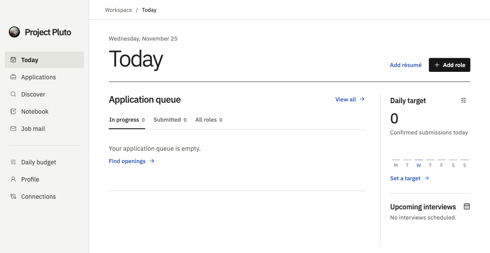
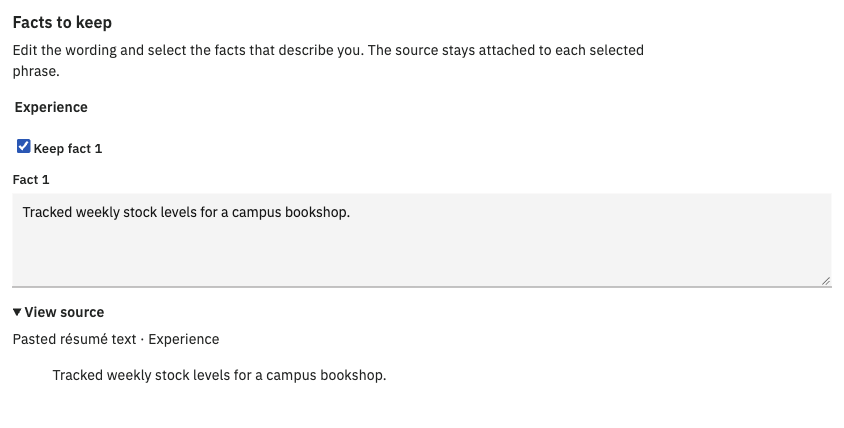
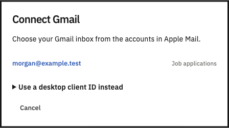

# Getting started with Project Pluto

This guide shows **Project Pluto v0.2.3**. Older GitHub installers may show different screens.

This walkthrough takes you from an empty workspace to a saved employer receipt. The screenshots follow a fictional applicant tracking an Inventory Analyst opening at Harborline Books. You can follow along with a real posting and leave it at **Saved** until you’re ready to apply.

## 1. Open your workspace

Launch **Project Pluto** on your Mac or Windows computer. The first screen, **Today**, shows an empty application queue. Choose **Add résumé** at the top right to get started. You can track a role on this device before connecting an inbox or an AI account. [Choose the right installer](install.md#choose-an-installer)

## 2. Review your résumé

Use **Choose résumé file** to open a PDF, DOCX or TXT file up to 5 MiB, or expand **Paste résumé text**. If a scanned PDF gives you empty or jumbled text, paste a readable copy. Then select **Review facts**.

Under **Facts to keep**, open **View source** to compare a suggestion with your original wording. Edit the fact or clear its checkbox. If the original résumé text also needs a correction, use **Back** to edit it. Choose **Continue to preferences** and enter any target roles or locations.

On **Set your job preferences**, find **Experience stories** and choose **Add story**. Give your example a title and describe the context, what you did, and the result. Morgan’s book swap is an example from outside work. For the result, Morgan describes how families could find the right shelf on their own.

A new story starts with **Use in application drafts** unchecked. Select it if you want your drafting provider to receive that story when you request a draft, then choose **Save story**. You can change that permission later with **Edit story**.

Choose **Edit application answers** to keep private details handy for employer forms, such as your availability or work authorization by country. Leave a yes/no question **Unanswered** until you have an answer. Choose **Save answers**, then use **Review saved answers** to check what you entered. These details stay out of AI drafts.

During setup, the stories and answers are held for your final review. Choose **Review profile**, check the confirmation box, and select **Save confirmed profile**. When you return to **Profile**, you can save changes directly in each editor or choose **Cancel** to discard an edit.

## 3. Find an opening

Open **Discover**. Under **Sources**, choose **Use the Simplify new grad list**, then **Add source**. This public GitHub list works without an account. For another public careers page, paste its URL and choose **Add source**. Searching a non-GitHub careers page uses your Firecrawl connection.

Check the lists you want to search. Enter a title or location under **Role and location**, then select **Search saved sources**. Choose **Review role** beside a match. Already have a posting? Go straight to **Applications → Add role**. [More about sources and daily discovery](sources.md)

## 4. Save the role and apply

Check the company, job title and **Employer posting URL**. Choose **Use profile résumé** if you want to start with your saved text, then review it for this role. Keep the stage at **Saved**, or choose **Preparing** while you work. Select **Save application**.

When ready, use **Save résumé PDF** if you need an attachment. Choose **Open employer application**, check that the posting is still open, and complete the employer’s form. Review your answers and attachments before submitting there.

## 5. Record and find the receipt

Once the employer confirms receipt, return to the role in **Applications**. Check that **Reviewed résumé text** and **Application draft** match what you sent. Under **Application status**, choose **Applied**, paste the employer’s confirmation text or number into **Employer evidence (required)**, and select **Save application**.

If you’re unsure whether the form went through, keep the role at **Preparing** and check the employer portal or confirmation email before trying again.

Open **Submitted copy** to see the receipt and the résumé and draft saved with it. On **Today**, the role appears under **Submitted** and counts toward the daily target on the date you recorded the receipt.

## 6. Check recruiting email (optional)

In **Job mail**, choose **Connect an inbox**, then select **Connect Gmail** or **Connect Outlook** under **Email**. Follow the permission prompt or, on a Mac, choose the account offered through Apple Mail. If your copy asks for a desktop client ID, see the [mailbox setup guide](mail.md).

If you used the Mac picker, look for your address followed by **via Apple Mail** under **Email**. Return to **Job mail**, select the mailbox and tracked job, then choose **Check for replies**. Open a matching subject, confirm the employer and role, and choose **Link reply to this job** to save a note. If the message confirms submission, record its evidence in the role under **Application status**.

## 7. Set a daily target (optional)

Open **Daily budget** and enter your **Jobs per day**. Choose a **Pricing scenario** and open **Token and pricing assumptions** to enter your model’s rates and any separate tool charges. The **30-day forecast** estimates costs or usage at that pace. Move across the chart or use its arrow keys to inspect a day. Choose **Save budget** to show the target alongside confirmed submissions on **Today**. [How the budget is calculated](budget.md#calculation)

In this example, a target of five jobs per day gives 75 jobs **Through day 15**. The shaded band shows the range of estimated costs over time.

To save a reviewed résumé to Google Drive, open **Connections → Google Drive**. A configured copy opens Google in your browser so you can choose your account. [Connect Google Drive with pictures](drive.md)
