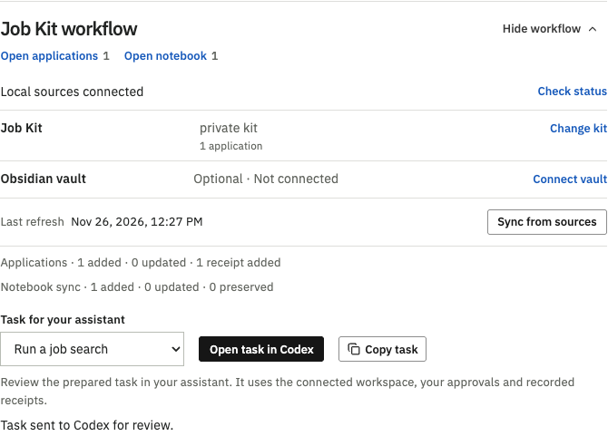

# Use your Job Kit in Project Pluto

Open **Today → Job Kit workflow → Show workflow**. Choose **Connect kit** and select the private folder containing `exports/applications.json`. On first launch, **Connect existing job kit** offers the same picker. Choose **Connect vault** if you also use the Obsidian vault generated by the kit.



Open **Applications** to see roles and recorded submissions, or **Notebook** to read evidence and interview notes. A scheduled interview appears on Today. Use **Sync from sources** after your assistant updates the tracker. A managed local tracker also shows the last time its background refresh finished. If you changed an imported note in Pluto, the next sync preserves that edit.

Choose a task to run a search, review employer replies or prepare for an interview. **Open task in Codex** opens a composer in the installed desktop app with your task and private workspace already filled in. Review it and press Send there. **Copy task** gives you the same instructions for another assistant with access to those folders. The task includes the local dashboard database so the assistant can check your latest edits and receipts before retrying a role. Your existing assistant handles employer forms and uses the permissions saved with the kit. Connecting a folder or opening Today does not start a submission.

## Desktop contract

```js
import { createJobKit } from './job-kit.mjs'

const jobKit = createJobKit({ prefs: config.prefs, workspace, dialog, window: () => win })
await jobKit.status()
await jobKit.choose({ kind: 'kit' }) // or 'vault'
await jobKit.sync()
```

All methods return `{kit, vault, lastSync, handoff}`. A picker response also contains `canceled`. The renderer passes only the source kind. The native directory dialog supplies the path to the main process.

| Field | Meaning |
| --- | --- |
| `kit`, `vault` | Each contains `connected`, the selected folder’s `name`, `stats` and `lastSyncedAt`. Unset values are null. A connection records a validated choice. Selection validates and syncs the folder before replacing an existing connection. |
| `stats` | Counts of `applications`, `interviews` and Markdown `notes` at the latest successful scan. Vault notes include supported application and interview pages. Kit interview counts include all recorded statuses. |
| `lastSync` | Null until sync. Then includes the attempt time `at`, record counts `imported`, `updated`, `unchanged`, `preserved`, and an `issues` array. Kit scans also return the application importer’s aggregate result in `jobs` when main supplies `workspace.importKitJobs`. See each source’s `lastSyncedAt` for its last completed read and import. |
| `handoff` | A fixed public skill `url` and a copyable `prompt` for a separate assistant session. |

The adapter owns local preferences under `jobKit.`. Main reads its separate `jobkit.managed` preference and adds `managed` to IPC responses. The current bridge summary contains `configured`, the tracker and vault display names, `ok` and `lastCompleted`, or null when unconfigured. The bridge owns its refresh and private configuration.

Main can call the synchronous `jobKit.getPaths()` for a user initiated copy task or folder open. It returns `{kit, vault}` with a verified directory path or null for each source. Keep this method inside main. A moved, unavailable or replaced directory requires a fresh selection before it can be opened.

## Supported files and evidence

| Source | Contents copied into Notebook |
| --- | --- |
| Kit workspace | One note per row of `exports/applications.json` and per stable event ID from `interviews/*.json`. JSON fields retain the source’s status, dates, evidence, notes and references, including cancelled or completed interviews. |
| Exported Obsidian vault | The kit’s managed `Home.md`, `Calendar.md`, generated `Application Board.md`, and managed Markdown pages directly under `Applications/` and `Interviews/`. The copy includes text outside the managed block, including “My notes.” |

The kit’s SQLite database contains its full event history. Pluto reads the kit’s generated application JSON snapshot, which carries the current evidence field. Refresh that export in the kit to bring in later changes. Evidence URLs, posted résumé paths and references remain text. Pluto leaves original files in place. For a kit workspace, the adapter also passes the original application rows and interview records to the workspace tracker via `importKitJobs(sourcePath, jobs, meetings)`, which owns stage and receipt mapping for Applications and Today. The Notebook keeps its own copies of the source records, including uncertain submissions and standalone interviews.

Repeat sync reuses the same note ID for the same record in the same folder. When a source record changes, Pluto updates an untouched copy and keeps the previous application or interview record in a separate Notebook note. Dashboard pages reflect their latest source text. A local edit to a note’s title, body or job link protects the whole note. The sync counts it as preserved. To reconcile it, keep any personal text in a separate note and make the protected copy match the source again. Removing a source record leaves its Notebook copy available. Selecting a different folder starts a separate set of copies.

Folder selection and sync read bounded UTF-8 data files. Pluto skips nested folders, vault plugins and unrelated pages. It does not follow linked files, run kit scripts, interpret embedded instructions, open evidence links, or read profile, demographic, permission or credential files. A scan accepts up to 5,000 records and 32 MiB per source, with a 16 MiB application export limit and 2,000,000 bytes per individual source file. Each Notebook body must also fit the workspace’s 2,000,000 character limit. An invalid or oversized source reports an issue and keeps its previous successful scan. A second connected source can still sync.

For a draft in an assistant that supports the kit, use the supplied prompt and choose the role and private workspace there. Review the existing tracker before preparing another application. [Public job application autofill skill](https://github.com/Jwarren-ENG/lockedin-job-kit/blob/main/skills/job-application-autofill/SKILL.md)

Run `node --test tests/job-kit.test.mjs` to exercise selection, mirror updates and evidence preservation with synthetic records.
